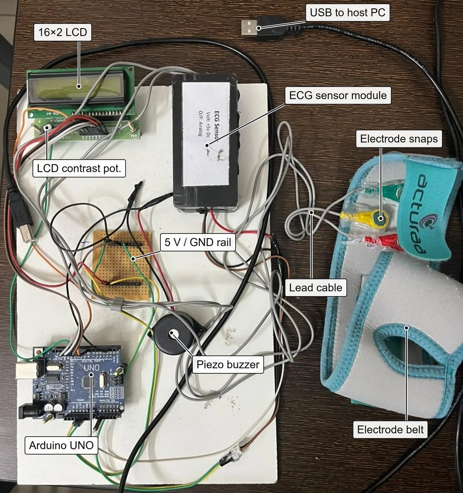
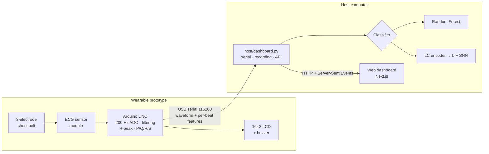
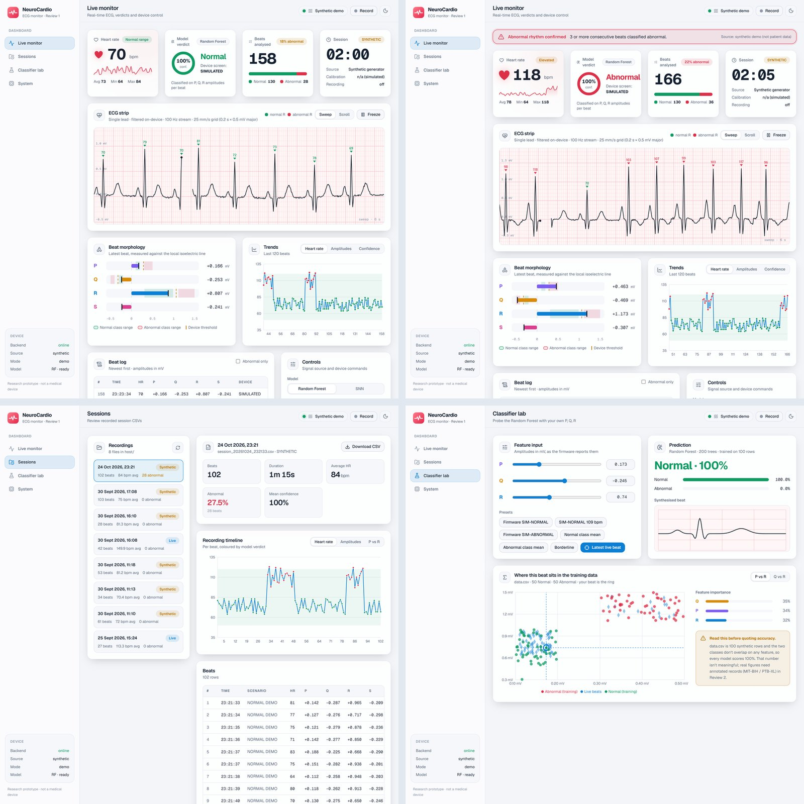

<div align="center">

# NeuroCardio

### Neuromorphic, spike-driven ECG analysis for low-power wearable devices

A low-cost single-lead ECG prototype, a live web dashboard, and a **level-crossing
spiking neural network (LC-SNN)**: the most power-efficient classifier in this project.




</div>

---

## Contents
- [Why NeuroCardio](#why-neurocardio)
- [Key results](#key-results)
- [System architecture](#system-architecture)
- [Repository layout](#repository-layout)
- [Quick start](#quick-start)
- [Web dashboard](#web-dashboard)
- [Hardware](#hardware)
- [Training the SNN](#training-the-snn)
- [Limitations](#limitations)
- [Team](#team)

---

## Why NeuroCardio

Continuous ECG monitoring can catch arrhythmias that a short clinical recording
misses, but conventional deep-learning pipelines process every sample of every
beat at a fixed rate, and a battery-powered wearable can't sustain that.

NeuroCardio takes the **neuromorphic route**. Each heartbeat is converted into a sparse
train of **ON/OFF spikes by level-crossing sampling**, so samples are only produced
when the signal actually changes. A **spiking neural network** of leaky
integrate-and-fire neurons then classifies the beat. Computation happens only when a
spike arrives, and each operation is a cheap addition rather than a multiplication.

## Key results

Evaluated on **109,460 beats** from all 48 records of the MIT-BIH Arrhythmia
Database with a record-level split (no patient leakage). The test set has 19,144 beats.

### ⚡ The SNN is the most power-efficient model

| | **LC-SNN** | 1D CNN | Random Forest |
|---|:---:|:---:|:---:|
| Trainable parameters | **1,186** | 9,282 | 300 trees |
| Input samples processed | **23.5 %** (76.5 % sparse) | 100 % | 100 % |
| First-layer operations per beat | **≈ 965** additions | 4,096 (dense) | n/a |
| Estimated energy per beat¹ | **≈ 29 nJ** | ≈ 809 nJ | n/a |
| Arithmetic | add-only (binary spikes) | multiply-accumulate | comparisons |

- **7.8× fewer parameters** than the CNN.
- **≈ 4.2× fewer first-layer synaptic operations**, because three out of four time steps carry no event.
- **≈ 28× lower estimated energy per beat** than the CNN.
- The **highest sensitivity** of the three models (78.2 %) and the highest negative predictive value (0.948): it misses the fewest abnormal beats.

¹ *An event-driven estimate from operation counts (45 nm CMOS: 0.9 pJ per accumulate,
4.6 pJ per multiply-accumulate; Horowitz, ISSCC 2014) for the device-matched model in
[`notebook/`](notebook/). It's an estimate for neuromorphic or event-driven hardware,
not a measurement. Simulating an SNN on a CPU or GPU doesn't save energy.*

### Classification (test set, abnormal = positive class)

| Model | Accuracy | Precision | Sensitivity | Specificity | F1 | ROC-AUC |
|---|:---:|:---:|:---:|:---:|:---:|:---:|
| Random Forest | **0.892** | **0.672** | 0.747 | **0.923** | **0.708** | 0.888 |
| 1D CNN | 0.861 | 0.581 | 0.748 | 0.885 | 0.654 | **0.903** |
| **LC-SNN** | 0.829 | 0.508 | **0.782** | 0.839 | 0.616 | 0.867 |

The Random Forest is the most accurate model today. The SNN trades some precision
for the best sensitivity at a fraction of the compute, which is the trade-off an
always-on wearable needs.

## System architecture



**On-device signal chain (firmware):** 200 Hz sampling → 4-tap moving average
(spectral nulls exactly at 50 Hz and 100 Hz mains) → IIR high-pass (baseline wander)
→ adaptive-threshold R-peak detector with a 250 ms refractory period → P/Q/R/S
amplitudes measured against the local isoelectric line → LCD, buzzer and serial
stream. A lead-off watchdog reports `LEAD OFF` instead of a false heart rate.

## Repository layout

```
NeuroCardio/
├── firmware/NeuroCardio_Review1/   Arduino UNO sketch (acquisition, DSP, LCD, alarm)
├── host/
│   ├── dashboard.py                backend: serial reader, synthetic source, classifiers, REST + SSE API
│   ├── snn_preview.py              level-crossing encoder + LIF network used by the dashboard's SNN view
│   ├── train_model.py              trains the Random Forest (creates host/models/)
│   ├── host_monitor.py             terminal / matplotlib monitor
│   ├── web/                        lightweight built-in dashboard (no Node.js needed)
│   └── requirements.txt
├── frontend/                       Next.js 16 dashboard (TypeScript, Tailwind CSS, Recharts)
├── notebook/                       SNN training notebook (Colab / Kaggle / local)
└── docs/                           setup guide, firmware flowchart, figures
```

## Quick start

### 1. Backend (Python 3.10+)
```bash
pip install -r host/requirements.txt
python host/train_model.py            # once: builds host/models/
python host/dashboard.py              # synthetic signal, no hardware needed
```
To run on the real device, plug in the Arduino and use
`python host/dashboard.py --port COM5` (or `/dev/ttyUSB0`).
Close the Arduino IDE's Serial Monitor first, because only one program can hold the port.

### 2. Dashboard (Node.js 20+)
```bash
cd frontend
npm install
npm run dev                           # http://localhost:3000
```
`python host/dashboard.py` also serves a no-install fallback dashboard at
http://127.0.0.1:8050.

### 3. Firmware
Open `firmware/NeuroCardio_Review1/NeuroCardio_Review1.ino` in the Arduino IDE, select
**Arduino Uno** and upload. No extra libraries are needed (`LiquidCrystal` ships with the IDE).

> **No electrodes yet?** Press **`t`** (from the dashboard's *Test signal* button or the
> serial monitor) to inject the firmware's built-in normal or abnormal test beats. This is a
> signal-injection self-test of the full chain.

## Web dashboard



| View | What it shows |
|---|---|
| **Live monitor** | ECG strip on a 25 mm/s grid with R peaks marked; heart rate and zone; verdict and confidence; P/Q/R/S morphology against class ranges; trends; beat log; device controls; an alarm banner after **3 consecutive abnormal beats** |
| **Sessions** | every recorded session, with a heart-rate and amplitude timeline, P-vs-R scatter, beat table and CSV export |
| **Classifier lab** | set P, Q, R by hand or from presets and watch the prediction and where the beat sits in the training data |
| **System** | signal chain, firmware design and serial protocol |

**Model switch:** the Controls card toggles between **Random Forest** and **SNN**. In SNN
mode the dashboard shows the spiking pipeline running on every beat: the 60-sample beat
window, its ON/OFF level-crossing spikes, the LIF layers' spike rasters and the synaptic-operation
count. *Until the trained SNN weights (`host/models/neurocardio_snn.pt`) are loaded,
this view uses an untrained preview network and the verdicts come from the Random Forest.
The dashboard labels this.*

## Hardware

| Component | Role |
|---|---|
| 3-electrode chest belt (RA, LA, RL reference) | picks up the cardiac potential |
| Analog ECG sensor module (+5 V, analog out) | amplification and filtering |
| Arduino UNO (ATmega328P, 16 MHz, 10-bit ADC) | sampling, DSP, R-peak detection, feature extraction |
| 16×2 character LCD (parallel, 4-bit) | heart rate, P/Q/R amplitudes, result |
| Piezo buzzer | beat click and abnormal-rhythm alarm |
| USB cable to host | power and serial data (115200 baud) |

**Pin map** (from the sketch; change the constants at the top to rewire):

| Signal | UNO pin | | Signal | UNO pin |
|---|---|---|---|---|
| LCD RS | D13 | | LCD D6 | D9 |
| LCD EN | D12 | | LCD D7 | D8 |
| LCD D4 | D11 | | ECG output | A1 |
| LCD D5 | D10 | | Buzzer | D2 |

**Serial protocol:** `D,<q4>` filtered waveform sample (100 Hz) · `B,ms,bpm,P,Q,R,S,result`
one detected beat · `# …` status lines. Single-letter commands: `t` test signal, `c` calibrate,
`s` stream, `b` beep, `d` analog-pin finder, `h` debug, `r` reset.

Step-by-step wiring and first-run instructions are in [`docs/SETUP_FROM_ZERO.md`](docs/SETUP_FROM_ZERO.md).

## Training the SNN

[`notebook/NeuroCardio_SNN_Training.ipynb`](notebook/) trains the SNN that the dashboard
runs. It works on **Google Colab, Kaggle or local Jupyter** and detects which one it's on.

- **Device-matched data:** MIT-BIH beats pass through a software copy of the firmware
  (ADC, moving-average notch, high-pass, 100 Hz stream). It matches the integer firmware to within 1 LSB.
- **Labels and split:** AAMI N vs non-N, with the DS1/DS2 inter-patient split.
- **Encoding and network:** 2-channel ON/OFF level-crossing encoding, then a 2-layer LIF network
  (snnTorch, surrogate gradients).
- **Model selection:** best-epoch checkpointing and a decision threshold tuned on validation.
- **Reporting:** sparsity, synaptic operations and an energy estimate, compared with a Random Forest and a 1D CNN.
- **Export:** `neurocardio_snn.pt`, with every pre-processing parameter, ready for the dashboard.

See [`notebook/README.md`](notebook/README.md) for step-by-step instructions.

## Limitations

- **Research prototype, not a medical device.** There is no isolation barrier or certification, and it
  must not be used for diagnosis.
- **Single lead, three electrodes:** enough for rate and gross morphology, not 12-lead diagnosis.
- **Offline results:** the numbers above come from MIT-BIH. Accuracy on the prototype's own
  electrode signal, and real power and latency, haven't been measured yet.
- The dashboard's Classifier lab uses a small demonstration Random Forest trained on 100
  synthetic rows. Its 100 % confidence isn't a performance figure.

## Team

**Aurnav Tyagi(23BDS1077) · Shreyash Khare(23BRS1039) · Arpan Dey(23BPS1141)**
School of Computer Science and Engineering (SCOPE)

**Faculty guide: Suhasini S**
School of Electronics Engineering (SENSE)

Vellore Institute of Technology, Chennai

<sub>Paper: *Neuromorphic Processing System with Spike-Driven ECG Analysis for Wearable Devices.*</sub>
